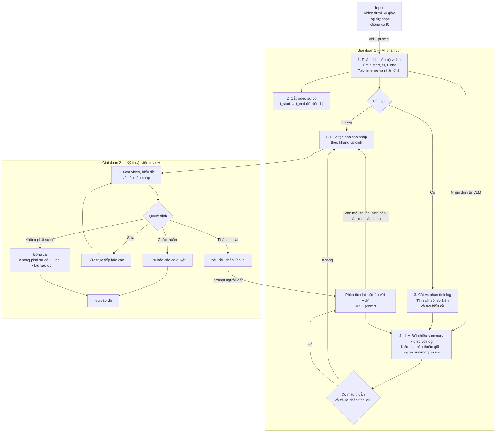

# AI agent flow



# Baseline Agent Flow

<aside>
🎯

Baseline chỉ nhận **video ngắn dưới 60 giây** hoặc **video ngắn kèm log**. Dữ liệu được giả định đã kiểm tra và chuẩn hóa trước khi vào graph. Input không có sẵn `t0`.

</aside>

## 1. Flow ngắn gọn

**Nhận video → VLM tìm `t_start`, `t0`, `t_end` → cắt video sự cố → nếu có log thì cắt và phân tích log → LLM đối chiếu video với log → LLM điền từng phần của báo cáo nháp theo khung cố định → kỹ thuật viên review → backend lưu hoặc chạy lại phần cần thiết.**

## 2. Các node chính

### Node 1 — Video Analyze

**Hàm:** `analyze_video(Prompt, vidieo)`

VLM nhận toàn bộ video và trả về:

- `t_start`: thời điểm sự cố bắt đầu.
- `t0`: thời điểm tai nạn.
- `t_end`: thời điểm sự cố kết thúc.
- Timeline trước, trong và sau sự cố.
- Summary : bản báo cáo mô tả vidieo

Ví dụ output:

```json
{
  "t_start": 11.2,
  "t0": 12.5,
  "t_end": 15.1,
  "timeline": [],
  "Accident description": str
}
```

---

### Node 2 — Cut Incident Video

**Hàm:** `cut_incident_video(t_start, t_end, vid_url)`

Cắt video theo:

```
[t_start, t_end]
```

Output:

- `incident_clip_uri`.
- Các frame đại diện trong đoạn sự cố.

Clip này dùng để:

- Hiển thị cho kỹ thuật viên.

---

### Node 3 — Cut & Analyze Log

**Hàm:** `cut_and_analyze_log(t_start, t_end, log_url)`

Node này chỉ chạy khi input có log.

Hệ thống cắt log trong:

```
[t_start, t_end]
```

Sau đó code thực hiện:

- Tính tốc độ đầu, cuối, nhỏ nhất và lớn nhất.
- Tính mức giảm tốc lớn nhất.
- Tìm thời điểm brake tăng mạnh.
- Tìm thay đổi lớn của steering angle.
- Tìm thời điểm disengagement hoặc tài xế tiếp quản.
- Lấy warning và error code trong đoạn sự cố.

### Cách phân tích log

| Cách | Ưu điểm | Nhược điểm |
| --- | --- | --- |
| Đưa toàn bộ log vào LLM | Dễ làm nhanh. | Tốn token, khó kiểm soát số liệu và dễ đọc sai log dài. |
| Vẽ biểu đồ rồi đưa ảnh cho VLM | Dễ nhìn xu hướng. | Có thể mất giá trị chính xác và phải gọi thêm model hình ảnh. |
| Code tính chỉ số + tạo biểu đồ + gửi JSON tóm tắt cho LLM | Giữ số liệu chính xác, dễ kiểm thử và vẫn trực quan. | Cần định nghĩa các signal và rule ban đầu. |

**⇒ Baseline chọn cách thứ ba**

### Biểu đồ cho cách 3

Tạo bốn biểu đồ theo thời gian:

1. Tốc độ và gia tốc.
2. Brake và throttle.
3. Steering angle.
4. Trạng thái tự lái, disengagement và warning.

Trên mỗi biểu đồ đánh dấu `t_start`, `t0`, `t_end`.

Output:

```json
{
  "log_slice_uri": "storage://INC-001/log_slice.csv",
  "chart_uris": [],
  "log_summary": {
    "speed_start": 32.0,
    "speed_end": 18.0,
    "max_deceleration": -6.2,
    "max_brake": 0.82,
    "disengagement_time": 12.8,
    "warnings": []
  },
  "log_events": []
}
```

---

### Node 4 — Align & Verify Claims

**Hàm:** `align_and_verify_claims(state)`

Node này chỉ chạy khi có log.

Hệ thống kiểm tra từng nhận định từ video:

| Trạng thái | Ý nghĩa |
| --- | --- |
| `supported` | Log có dữ liệu hỗ trợ nhận định video. |
| `contradicted` | Log có dữ liệu mâu thuẫn với nhận định video. |
| `unverified` | Log không có signal phù hợp để kiểm tra. |

Ví dụ:

- Video: “Xe phanh mạnh tại 12.5 giây”.
- Log: brake tăng từ `0.1` lên `0.82` gần 12.5 giây.
- Kết quả: `supported`.

### Phân tích lại tự động một lần

Khi có ít nhất một claim `contradicted`:

1. Lấy `clip_uri`.
2. Tạo prompt chỉ mô tả các điểm video và log đang lệch nhau (agent prompt hoặc human prompt).
3. Đưa clip và prompt vào VLM hàm `analyze_video(state)`
4. Chạy lại `align_and_verify_claims`.

Mỗi incident chỉ được tự động phân tích lại **một lần**.

Prompt mẫu:

```
Hãy xem lại đoạn video này trong khoảng t_start đến t_end.
Kết quả trước đó cho rằng xe phanh mạnh tại 12.5 giây,
nhưng log không ghi nhận brake tăng tại thời điểm tương ứng.
Chỉ kiểm tra lại nhận định này.
Trả về quan sát mới, timestamp và frame làm bằng chứng.
Không sửa các nhận định khác.
```

Nếu sau lần chạy lại vẫn mâu thuẫn, hệ thống giữ trạng thái `contradicted` và đưa cảnh báo vào báo cáo nháp.

---

### Node 5 — Build Draft Report

**Hàm:** `build_draft_report(state)`

Tạo sẵn khung báo cáo. LLM không tự tạo cấu trúc mới.

**Gọi LLM theo phase để sinh toàn bộ báo cáo structured output**. LLM trả về nội dung cho từng đề mục; backend chèn nội dung vào khung.

### Khung báo cáo cụ thể

| Đề mục | Nguồn tạo |
| --- | --- |
| 1. Thông tin chung | Backend điền: incident ID, video URI, có log hay không. |
| 2. Khoảng thời gian sự cố | Backend điền: `t_start`, `t0`, `t_end`. |
| 3. Tóm tắt sự cố | LLM viết ngắn gọn 3–5 câu kèm trích dẫn log. |
| 4. Timeline | LLM diễn đạt từ timeline có timestamp đã được cung cấp. |
| 5. Quan sát từ video | LLM tổng hợp tác nhân, hành vi và điều kiện. |
| 6. Kết quả log | LLM diễn giải `log_summary`; nếu không có log thì ghi “Không có dữ liệu log”. |
| 7. Đối chiếu video và log | Backend đưa trạng thái từng claim; LLM chỉ giải thích ngắn gọn. |
| 8. Nguyên nhân giả thuyết | LLM viết thận trọng, không được khẳng định nguyên nhân gốc. |
| 9. Bằng chứng và cảnh báo | Backend điền evidence ID, clip, frame, log signal và các conflict. |
| 10. Trạng thái review | Backend điền sau khi kỹ thuật viên review. |

Output LLM:

```json

```

LLM phải dựa hoàn toàn vào số liệu, không được bịa

---

### Node 6 — Human Review

**Hàm:** `human_review_interrupt(state)`

Kỹ thuật viên xem:

- Video gốc và clip sự cố đã cắt.
- Các biểu đồ log.
- Timeline.
- Claim và bằng chứng.
- Báo cáo.

Các lựa chọn:

- **Chấp thuận:** backend lưu báo cáo.
- **Sửa trực tiếp:** backend cập nhật nội dung, không gọi LLM.
- **Yêu cầu phân tích lại:** chạy lại clip hoặc trường được chọn.
- **Không phải sự cố:** lưu lý do và đóng ca.