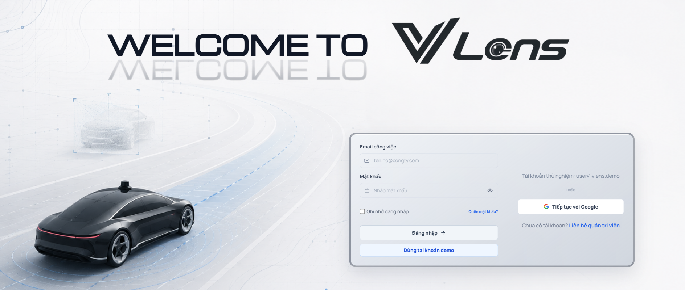
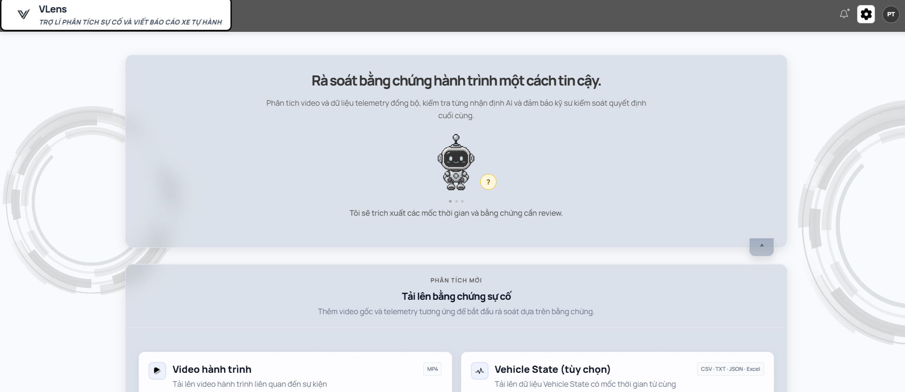
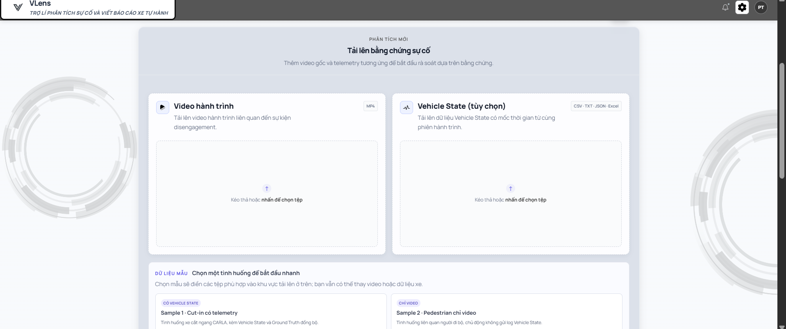
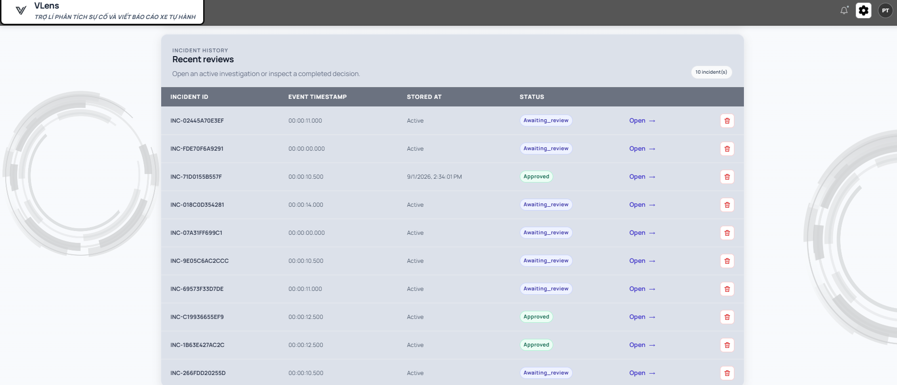
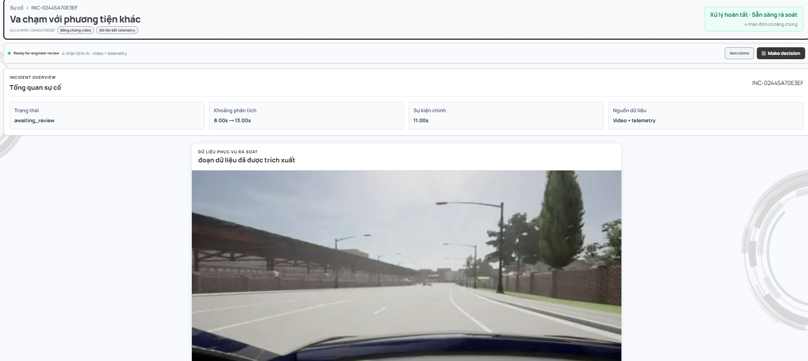
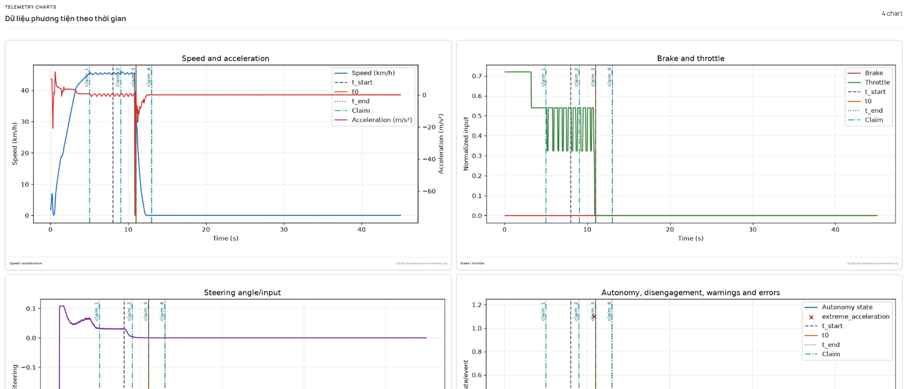
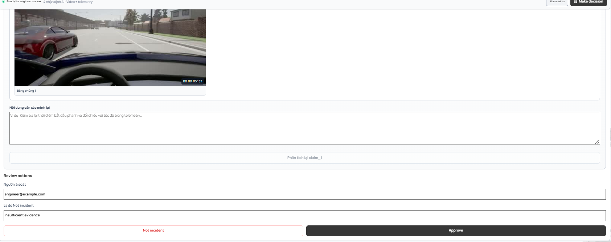
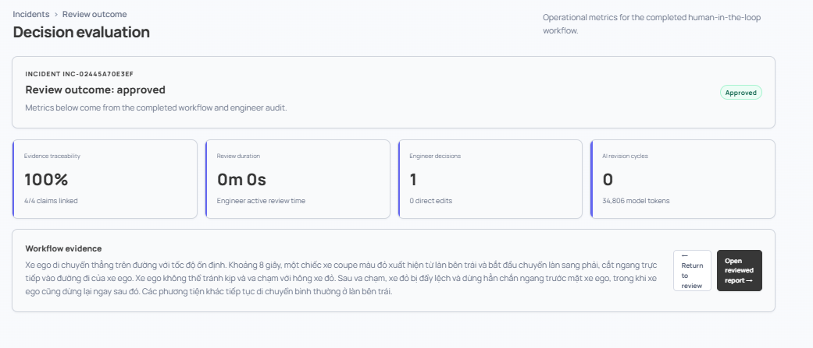

# Incident Analysis Agent

Backend FastAPI + LangGraph phân tích video giao thông dưới 60 giây, kết hợp log xe tùy chọn, tạo báo cáo 10 mục và dừng tại bước kỹ thuật viên review. Dự án có Streamlit client độc lập trong `main_test.py` để chạy toàn bộ lifecycle qua HTTP API.

## Live Demo

Truy cập sản phẩm tại: [https://vlens.site/](https://vlens.site/)

## Team T207-Cá Hồi

Các vai trò và nhiệm vụ được phân chia đồng đều để bảo đảm mọi thành viên đều tham gia và đóng góp trên nhiều mảng của dự án, thay vì chỉ phụ trách duy nhất một domain. Mỗi thành viên có một vai trò chính; các thành viên còn lại có trách nhiệm cùng tham gia, phối hợp và hỗ trợ khi cần thiết.

| Thành viên | Mã học viên | Vai trò và nhiệm vụ chính |
|------------|-------------|---------------------------|
| **Nguyễn Phương Đông** | 2A202601474 | Nghiên cứu và phát triển bộ não AI; Prompt Engineer; thiết kế luồng VLM. |
| **Nguyễn Quang Huy** | — | Backend; deploy; nghiên cứu telemetry; thu thập dataset. |
| **Trần Trọng Nghĩa** | — | Nghiên cứu thuật toán và model Computer Vision; tối ưu code; kiểm thử. |
| **Phan Trần Tường Vy** | — | UI/UX; frontend; quản lý dự án (PM); thu thập dataset; kiểm thử. |

## MVP capabilities

- Phân tích video dưới 60 giây để tạo incident window, timeline, claim và evidence có timestamp.
- Đối chiếu claim với telemetry CSV theo các trạng thái `supported`, `contradicted`, `unverified`; có focused re-analysis giới hạn khi có mâu thuẫn.
- Cắt clip/artifact, report 10 phần và LangGraph interrupt để kỹ sư approve, edit, reanalyze hoặc đánh dấu không phải sự cố.
- Frontend Next.js để upload và review evidence; video native có thể blur khuôn mặt/biển số trước khi gửi VLM.

Xem [kiến trúc](ARCHITECTURE.md), [phương pháp đánh giá](docs/EVALUATION.md) và [privacy/redaction](docs/PRIVACY.md). Đây là MVP hỗ trợ review, không thay thế quyết định của kỹ sư.

## Screenshots giao diện

### Đăng nhập



### Tổng quan hệ thống



### Tải video và dữ liệu telemetry



### Lịch sử incident



### Không gian rà soát sự cố



### Biểu đồ telemetry



### Thao tác human-in-the-loop



### Đánh giá quyết định



## Luồng xử lý

```text
video + optional log
  → VLM tìm t_start, t0, t_end, timeline và claims
  → cắt incident clip + representative frames
  → nếu có log: cắt log + metrics/events + 4 charts + verify claims
  → nếu có conflict: focused VLM re-analysis tối đa 1 lần + verify lại
  → backend lắp báo cáo cố định 10 mục
  → LangGraph interrupt chờ human review
  → approve | edit | reanalyze | not_incident
  → SQLite checkpoint + terminal report repository
```

`edit` chỉ sửa sáu trường narrative và quay lại `awaiting_review`; không tự approve và không gọi LLM. `reanalyze` bắt buộc có feedback cùng target claim IDs, sau đó tạo lại báo cáo và quay lại review. Chỉ `approve` và `not_incident` là terminal.

## Cài đặt

Yêu cầu Python 3.11 và FFmpeg. `MediaService` ưu tiên `ffmpeg`/`ffprobe` trong `PATH`; package `imageio-ffmpeg` cung cấp fallback cho FFmpeg.

```bash
python3.11 -m venv .venv
source .venv/bin/activate
pip install -r requirements.txt
cp .env.example .env
```

Cấu hình tối thiểu:

```dotenv
OPENAI_API_KEY=...
DASHSCOPE_API_KEY=...
INCIDENT_INPUT_ROOTS=./data_mock
INCIDENT_UPLOAD_DIR=./data/uploads
ARTIFACT_DIR=./data/artifacts
INCIDENT_DATABASE_PATH=./data/incident_reports.sqlite3
INCIDENT_CHECKPOINT_PATH=./data/incident_checkpoints.sqlite3
```

Incident clip mặc định có tối thiểu 5 giây, thêm 1 giây trước và 2 giây sau window do VLM xác định. Có thể điều chỉnh bằng `INCIDENT_CLIP_MIN_DURATION_S`, `INCIDENT_CLIP_PRE_ROLL_S` và `INCIDENT_CLIP_POST_ROLL_S`. Ảnh `representative_frame` được chọn gần `t0` thay vì lấy frame đầu tiên.

Khi incident có log, bước phân tích video nhận thêm một `log_attention_hint` định tính để biết timestamp nào cần xem kỹ. Hint chỉ mô tả ga thay đổi quá `0.2`, phanh thay đổi quá `0.5` hoặc góc đánh lái thay đổi quá `0.3`; tối đa 20 timestamp. Gia tốc không được dùng để tạo attention hint. VLM không nhận giá trị telemetry cụ thể, raw log hay evidence ID và không được dùng hint để kết luận tai nạn.

Khi đối chiếu claim với log, backend trước tiên chỉ giữ các dòng đồng thời nằm trong `incident_window` và `±LOG_TIMESTAMP_TOLERANCE_S` quanh timestamp của claim. `LOG_CLAIM_SAMPLE_RADIUS` sau đó giới hạn số mẫu lấy ở mỗi phía của mẫu gần nhất; mặc định `3` tạo tối đa 7 mẫu. Các dòng model nhìn thấy và `allowed_evidence_ids` luôn là cùng một tập. Nếu không có dòng hợp lệ, claim được giữ ở trạng thái `unverified`.

Gia tốc suy ra từ tốc độ có trị tuyệt đối lớn hơn `15 m/s²` được xem là outlier, không đưa vào metric verification. Backend ghi `LOG_ACCELERATION_OUTLIER_FILTERED` trong warnings để việc lọc không diễn ra âm thầm. Rule này chỉ lọc metric gia tốc bất thường, không tự kết luận có hoặc không có va chạm.

VLM chỉ dùng Qwen native video qua DashScope (`DASHSCOPE_API_KEY`). Video được resize/pad theo `VLM_VIDEO_TARGET_WIDTH`, `VLM_VIDEO_TARGET_HEIGHT` và chuẩn hóa FPS trước khi gửi. Video local nhỏ hơn `QWEN_BASE64_MAX_VIDEO_BYTES` (mặc định 7 MB) được gửi bằng Base64 Data URL. Video lớn hơn ngưỡng cần `QWEN_ARTIFACT_URL_BASE` công khai `ARTIFACT_DIR`. Qwen gọi `qwen3-vl-flash` qua DashScope chat completions. `OPENAI_API_KEY` vẫn chỉ dùng cho LLM, verification và report.

Streamlit upload file vào `INCIDENT_UPLOAD_DIR`; ngưỡng mặc định 200 MB của Streamlit được nâng lên 10 GB và backend không giới hạn dung lượng video. Backend vẫn kiểm tra phần mở rộng, path root, file tồn tại và video không quá 60 giây. File log vẫn chịu giới hạn `INCIDENT_MAX_LOG_BYTES`. URL từ xa và external object storage không thuộc baseline.

## Chạy backend và Streamlit

Terminal 1:

```bash
uvicorn src.main:app --reload --port 8000
```

Terminal 2:

```bash
streamlit run main_test.py
```

Swagger: `http://localhost:8000/docs`.

### LangSmith tracing

Tracing là tùy chọn và không thay đổi routing, retry, checkpoint hoặc output của workflow. Để bật tracing, tạo API key trong LangSmith rồi cấu hình `.env`:

```dotenv
LANGSMITH_TRACING=true
LANGSMITH_API_KEY=lsv2_...
LANGSMITH_PROJECT=incident-analysis-dev
LANGSMITH_TRACING_SAMPLING_RATE=1.0
```

Nếu API key thuộc nhiều workspace, thêm `LANGSMITH_WORKSPACE_ID`. Khởi động lại backend sau khi đổi `.env`. Mỗi incident được gắn `thread_id=incident_id`; lần chạy đầu và các lần resume/reanalysis vì vậy xuất hiện trong cùng một LangSmith thread. Model calls từ OpenAI Responses API và Qwen OpenAI-compatible API được hiển thị dưới graph trace. Raw ảnh/video Base64, signed media URL và API key được lọc trước khi gửi.

Để tắt hoàn toàn, đặt `LANGSMITH_TRACING=false`. Thiếu `LANGSMITH_API_KEY` cũng khiến integration tự tắt; lỗi gửi trace không làm incident workflow thất bại.

Trong Streamlit, chọn video bằng nút **Browse files** và chọn log CSV nếu có; không cần nhập đường dẫn file.

Workflow chạy đồng bộ đến Human Review nên VLM + verification + report có thể mất vài phút. Streamlit chờ tối đa 900 giây và hiển thị riêng lỗi kết nối, timeout hoặc response backend không phải JSON; xem terminal Uvicorn nếu backend báo HTTP 500.

Nếu OpenAI verification thất bại, workflow không còn kết thúc bằng lỗi: snapshot ghi warning và backend tạo báo cáo fallback từ `video_summary`, timeline và evidence trong claims mà VLM đã trả. Khi verification của incident có log không khả dụng, lần gọi report model được bỏ qua. Sau khi sửa `.env` hoặc cập nhật code, phải khởi động lại FastAPI và dùng incident ID mới vì incident cũ vẫn có checkpoint.

## Incident API

### Upload video và log

```http
POST /api/v1/incidents/uploads
Content-Type: multipart/form-data

video=<video file, bắt buộc>
log=<CSV file, tùy chọn>
```

Video hỗ trợ `.mp4`, `.mov`, `.avi`, `.mkv`, `.webm`; log hỗ trợ `.csv`. Response trả `video_uri` và `log_uri` nội bộ để dùng trong request tạo incident.

### Tạo incident

```http
POST /api/v1/incidents
Content-Type: application/json

{
  "incident_id": "INC-001",
  "video_uri": "data_mock/front_camera.mp4",
  "log_uri": "data_mock/vehicle_state.csv",
  "analysis_prompt": "Phân tích sự cố trong video."
}
```

### Lấy snapshot

```http
GET /api/v1/incidents/INC-001
```

Snapshot chỉ trả public lifecycle, báo cáo, claims, artifacts, warnings và audit; không trả raw graph state, API key, prompt nội bộ, remote provider handle hay chain-of-thought.

### Gửi review

```http
POST /api/v1/incidents/INC-001/review
Content-Type: application/json

{
  "action": "approve",
  "reviewer": "reviewer@example.com"
}
```

Các payload khác:

```json
{"action":"edit","reviewer":"tech","edits":{"summary":"Nội dung đã sửa"}}
{"action":"reanalyze","reviewer":"tech","feedback":"Kiểm tra lại phanh","target_claim_ids":["claim-1"]}
{"action":"not_incident","reviewer":"tech","reason":"Không phải sự cố an toàn"}
```

Create/review trả `202` khi đang chờ review, `200` khi terminal; `404` cho incident không tồn tại, `409` cho duplicate/sai lifecycle và `422` cho schema/input không hợp lệ.

## Báo cáo 10 mục

`DraftReport` gồm đúng 10 section:

1. Thông tin chung.
2. Khoảng thời gian sự cố.
3. Tóm tắt sự cố.
4. Timeline và typed events.
5. Quan sát video và typed observations.
6. Kết quả log và typed metrics/events.
7. Đối chiếu và typed claim verification.
8. Nguyên nhân giả thuyết.
9. Evidence/artifact/warnings.
10. Review status.

Report LLM chỉ sinh ba narrative fields: `timeline`, `video_observations`, `hypothesized_causes`. Backend sở hữu summary, log findings, alignment, timestamps, metrics, verification, evidence/artifact URI, warning và review status. Video-only luôn ghi `Không có dữ liệu log.`.

## Persistence

- `INCIDENT_CHECKPOINT_PATH`: SQLite LangGraph checkpoint để GET/resume incident `awaiting_review` sau process restart.
- `INCIDENT_DATABASE_PATH`: SQLite repository cho terminal `approved | not_incident`.
- Qwen không tạo remote handle; DashScope đọc native video từ URL công khai của artifact.
- SQLite checkpoint/repository chạy trên worker tuần tự, không thực thi SQLite sync trực tiếp trên event loop.
- `GET /live` chỉ kiểm tra process; `GET /ready` kiểm tra workflow, checkpointer và report repository. Docker dùng `/ready`.
- `PROVIDER_REQUEST_LIMIT_PER_INCIDENT` đặt hard limit request model; structured-output retry và network retry được cấu hình riêng.
- `INCIDENT_ARTIFACT_RETENTION_HOURS` và `MODEL_ACTIVITY_RETENTION_HOURS` kiểm soát retention.

## Kiểm thử

```bash
ruff check src tests main_test.py
ruff format --check src tests main_test.py
python -m compileall -q src tests main_test.py
pytest tests -v --tb=short
pip check
```

E2E tests chạy graph, API, SQLite restart, FFmpeg, log và chart thật với asset trong `data_mock/`; provider SDK chỉ được mock tại SDK boundary nên không phát sinh chi phí model.

## Evaluation

Evaluator chạy trực tiếp production graph trong `src`, không gọi FastAPI port 8000. API key, model và các cấu hình provider được đọc từ `.env` hiện có; checkpoint, report database và artifact phát sinh trong lúc eval dùng thư mục tạm nên không ảnh hưởng dữ liệu ứng dụng.

Chạy toàn bộ `golden_set/` bằng một lệnh:

```bash
.venv/bin/python -m eval.run --analysis-prompt "Phân tích sự cố giao thông trong toàn bộ video. Xác định t_start, t0, t_end, timeline và claims chỉ từ bằng chứng quan sát được."
```

Mỗi sample được ghi ngay vào `eval/results/<sample_id>.json`; metric trung bình của các sample được ghi vào `eval/results/metric.json`. Sample JSON có `has_reanalyze` để chỉ việc graph đã chạy auto/manual re-analysis. Khi mạng/API lỗi, sửa `.env` rồi chạy lại cùng lệnh: sample thành công được giữ nguyên, sample lỗi hoặc chưa có file sẽ chạy lại. Dùng `--force` nếu muốn chạy lại mọi sample.

## Giới hạn hiện tại

- Chưa có authentication/authorization, external object storage, queue phân tán hoặc production observability.
- SQLite phù hợp demo/single-process; deployment nhiều worker cần database/checkpointer có concurrency model phù hợp hơn.
- Live startup FastAPI/Streamlit và E2E mocked-provider đã được kiểm tra. Chưa gọi model thật vì không có explicit approval phát sinh chi phí, vì vậy kết quả không được tuyên bố production-ready.
