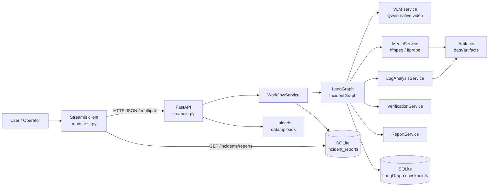
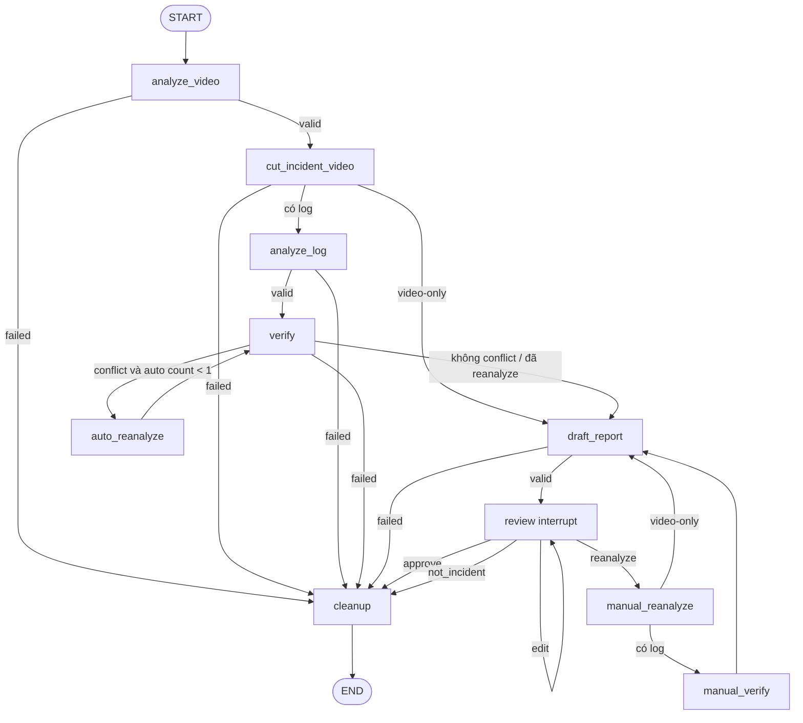

# Incident Analysis Agent — Kiến trúc và hướng dẫn chạy

Tài liệu này mô tả kiến trúc thực tế của backend hiện tại, cấu trúc thư mục, luồng xử lý incident, persistence bằng SQLite, API và cách chạy local/Docker.

## 1. Tổng quan

Hệ thống nhận một video giao thông ngắn, kèm log xe tùy chọn, rồi thực hiện:

```text
Video + log tùy chọn
        │
        ▼
Upload và kiểm tra input
        │
        ▼
VLM phân tích video → incident window, timeline, observation, claims
        │
        ▼
Cắt incident clip, lấy representative frame và artifacts
        │
        ├── Có log: phân tích log, metrics, events và charts
        │
        ▼
Đối chiếu claims video với evidence từ log
        │
        ├── Có conflict và `AUTO_REANALYSIS_ENABLED=true`: tự động re-analysis tối đa một lần
        │
        ▼
Dựng báo cáo 10 mục
        │
        ▼
Human review: approve | edit | reanalyze | not_incident
        │
        ▼
SQLite checkpoint và terminal report repository
```

Các thành phần chính:

- FastAPI cung cấp HTTP API và khởi tạo runtime trong lifespan.
- LangGraph điều phối workflow phân tích video/log và dừng tại human review.
- VLM chỉ xử lý video qua Qwen3-VL-Flash native video trên DashScope.
- Các service deterministic xử lý media, log, metrics, charts và validation.
- OpenAI verification/report service thực hiện đối chiếu claims và sinh narrative báo cáo.
- SQLite lưu checkpoint LangGraph và kết quả terminal sau review.
- Streamlit trong `main_test.py` là client độc lập để upload file, theo dõi incident và xem dữ liệu SQLite.

Đây là baseline demo/single-process. Hệ thống hiện chưa có authentication, queue phân tán, object storage bên ngoài hoặc thiết kế concurrency cho nhiều worker.

## 2. Sơ đồ kiến trúc



### 2.1. Ranh giới trách nhiệm

| Lớp                         | Trách nhiệm                                                                 | Không nên đặt ở đây                               |
| ---------------------------- | ----------------------------------------------------------------------------- | -------------------------------------------------------- |
| `src/api/`                 | Validate request, gọi application service, map lỗi thành HTTP response     | Logic phân tích video hoặc gọi SDK model trực tiếp |
| `src/services/workflow.py` | Quản lý lifecycle incident, state recovery, review và terminal persistence | Chi tiết prompt/provider                                |
| `src/agents/`              | Định nghĩa state graph, node và routing                                   | API key, HTTP upload, SQL query                          |
| `src/services/`            | Adapter provider, media/log/chart/report/repository                           | Điều phối branching của graph                        |
| `src/models/`              | Contract Pydantic và kiểu dữ liệu domain/API                              | Side effect, đọc file hoặc gọi model                 |
| `main_test.py`             | Giao diện Streamlit gọi API                                                 | Truy cập trực tiếp database hoặc chạy graph         |

## 3. Luồng LangGraph incident workflow

Graph chính được tạo trong `src/agents/incident_graph.py` và chạy qua `LangGraphIncidentRunner`.



### 3.1. Ý nghĩa từng node

1. `analyze_video`: normalize video, gọi Qwen VLM và lưu `VideoMemory`.
2. `cut_incident_video`: cắt clip theo `t_start`, `t0`, `t_end`; lấy incident frames và frame đại diện gần `t0`.
3. `analyze_log`: cắt log theo incident window, tính metrics/events và sinh chart. Node này chỉ chạy khi có `log_uri`.
4. `verify`: code tạo `claim_log_summary` riêng từ 3 mẫu trước/sau mẫu gần timestamp claim nhất, rồi chỉ gửi
   claim, summary đã tính, allowed evidence IDs và timestamp tolerance cho verification service.
5. `auto_reanalyze`: khi có claim bị `contradicted` và `AUTO_REANALYSIS_ENABLED=true`, gọi VLM tập trung vào claim conflict. Mỗi incident tối đa một auto re-analysis.
6. `draft_report`: dựng báo cáo cố định 10 mục từ structured facts và narrative do report service sinh.
7. `review`: dùng LangGraph `interrupt` để chờ quyết định kỹ thuật viên.
8. `manual_reanalyze`: xử lý re-analysis do reviewer yêu cầu, có feedback và target claim IDs.
9. `cleanup`: dọn remote media handle của provider cũ theo chính sách best-effort; Qwen không tạo remote handle.

### 3.2. Lifecycle và review action

| Trạng thái        | Ý nghĩa                                                                              |
| ------------------- | -------------------------------------------------------------------------------------- |
| `queued`          | Đã nhận nhưng chưa bắt đầu xử lý.                                            |
| `running`         | Graph đang xử lý hoặc đang re-analysis.                                           |
| `awaiting_review` | Đã có draft report và đang chờ người duyệt.                                   |
| `approved`        | Terminal outcome, báo cáo được duyệt và lưu SQLite.                            |
| `not_incident`    | Terminal outcome, reviewer xác nhận không phải sự cố.                            |
| `failed`          | Workflow không thể hoàn thành; warning/error được trả trong snapshot.          |
| `cancelled`       | Trạng thái dành cho lifecycle mở rộng; không có endpoint cancel trong baseline. |

| Action           | Kết quả                                                                                             |
| ---------------- | ----------------------------------------------------------------------------------------------------- |
| `approve`      | Chuyển sang`approved`, lưu final report.                                                          |
| `edit`         | Chỉ sửa sáu narrative field, quay lại`awaiting_review`; không tự approve và không gọi LLM. |
| `reanalyze`    | Bắt buộc`feedback` và `target_claim_ids`, chạy manual re-analysis rồi quay lại review.      |
| `not_incident` | Bắt buộc`reason`, chuyển sang terminal `not_incident`.                                         |

## 4. Cấu trúc thư mục

```text
.
├── src/
│   ├── main.py                         # FastAPI app, CORS và lifespan bootstrap
│   ├── config.py                       # Settings đọc từ .env / environment
│   ├── agents/
│   │   ├── graph.py                    # Agent chat demo cũ
│   │   ├── state.py                    # State của agent chat demo
│   │   ├── incident_graph.py           # LangGraph workflow chính
│   │   ├── incident_state.py           # TypedDict state của incident
│   │   ├── incident_routing.py         # Routing sau verification
│   │   ├── nodes/
│   │   │   ├── incident.py             # Video/log/verify/report nodes
│   │   │   ├── review.py               # Human review interrupt và edit allowlist
│   │   │   └── example_node.py         # Node của agent demo
│   │   └── tools/                      # Tool demo của agent chat
│   ├── api/
│   │   ├── routes.py                   # /chat, /status và include incident router
│   │   ├── incidents.py                # Upload/create/get/review/reports API
│   │   └── errors.py                   # Domain error → HTTP error
│   ├── models/
│   │   ├── incidents.py                # Domain contract: memory, claim, log, report
│   │   ├── api.py                      # Public request/response schema
│   │   └── schemas.py                  # Chat request/response schema
│   ├── prompts/
│   │   ├── video_analysis.py            # Prompt phân tích video
│   │   ├── reanalysis.py               # Prompt auto/manual re-analysis
│   │   ├── verification.py             # Prompt đối chiếu claim
│   │   └── reporting.py                # Prompt narrative báo cáo
│   └── services/
│       ├── incident_runtime.py         # Factory ghép dependency và SQLite checkpointer
│       ├── workflow.py                 # Application service của incident
│       ├── vlm.py                      # Qwen native video
│       ├── video_memory.py             # Giới hạn, batch và merge video memory
│       ├── media.py                    # Probe/normalize/cut/sample bằng FFmpeg
│       ├── log_analysis.py             # CSV slice, metrics và log events
│       ├── charts.py                   # Biểu đồ log
│       ├── verification.py             # OpenAI claim verification
│       ├── reporting.py                # OpenAI report narrative
│       ├── report_repository.py        # In-memory và SQLite terminal reports
│       ├── uploads.py                  # Multipart upload validation/storage
│       └── model_observability.py      # Model activity và token usage
├── main_test.py                        # Streamlit client độc lập
├── data_mock/                          # Video/log mẫu để chạy local/test
├── data/                               # Upload, artifact và SQLite runtime data
├── tests/                              # Unit/API/integration/E2E tests
├── docs/agent_backend/                 # Tài liệu kiến trúc, phase và work report
├── scripts/                            # Script local/log hook; đang được gitignore
├── .env.example                        # Mẫu environment configuration
├── requirements.txt                    # Python dependencies
├── Dockerfile                          # Image chỉ chạy FastAPI backend
├── docker-compose.yml                  # Backend + volume data
└── Makefile                            # Lệnh run/test/lint/format/check
```

## 5. Domain model và state

### `IncidentState`

`src/agents/incident_state.py` định nghĩa state serializable đi qua graph. Những nhóm field chính:

- Input: `incident_id`, `video_uri`, `log_uri`, `analysis_prompt`, `metadata`.
- Video: `video_memory`, `claims`, `remote_media_handles`.
- Log: `log_analysis`, `log_evidence_summary`, `log_events`, `chart_uris`.
- Verification: `claim_log_summaries`, `verification`, warning và conflict claim IDs.
- Report: `report_narrative`, `draft_report`, `artifact_uris`.
- Review: `review_target_claim_ids`, `review_feedback`, `last_review_action`, `review_audit`.
- Observability/error: `model_activities`, `error_code`, `error_message`, counters re-analysis.

State chỉ nên giữ structured data và URI cần cho workflow. Không đưa API key, raw video bytes, toàn bộ DataFrame hoặc chain-of-thought vào state/API response.

### VideoMemory và evidence

`VideoMemory` chỉ gồm `global_scene`, `video_summary`, `incident_window`,
`representative_timestamp_s`, `timeline`, `claims` và metadata kỹ thuật. Không còn các field VLM
`observations`, `uncertainties`, `source_frame_ids` hoặc danh sách `evidence` toàn cục.

- `timeline` có từ 3 đến 6 mốc quan trọng và chỉ giữ `evidence_ids` là frame ID thật.
- Mỗi `Claim` sở hữu `evidence` của chính nó; mỗi evidence chỉ có `evidence_id` và `timestamp_s`.
- Backend canonicalize evidence về frame đã gửi vào VLM, tự gắn evidence còn thiếu của timeline vào claim gần
  nhất, rồi reject output nếu timeline vẫn tham chiếu ID không tồn tại, evidence trùng ID, hay claim không có evidence.
- `verification_status` không nằm trong claim. `VerificationResult` là nguồn duy nhất cho đối chiếu log:
  `supported` cần evidence trực tiếp hỗ trợ, `contradicted` cần evidence trực tiếp trái claim, và `unverified`
  dùng khi log không đủ tín hiệu hoặc nằm ngoài timestamp tolerance. Chỉ `contradicted` trigger re-analysis.
- Mỗi `claim_log_summary` tính sẵn speed, brake, throttle, steer chuẩn hóa, vector acceleration, yaw có angle
  wrap, pitch/roll và Z. LLM không nhận toàn bộ raw log và không tự tính metric.

Đặt `AUTO_REANALYSIS_ENABLED=false` để giữ các claim `contradicted` trong báo cáo mà không gọi lại VLM tự động.

### Báo cáo 10 mục

`DraftReport` gồm:

1. `general_information`
2. `incident_window`
3. `summary`
4. `timeline`
5. `video_observations`
6. `log_findings`
7. `alignment`
8. `hypothesized_causes`
9. `evidence_and_warnings`
10. `review_status`

LLM chỉ viết các narrative cần thiết. Backend sở hữu timestamp, evidence, metrics, kết quả verification, artifacts, warnings và review status.

## 6. Persistence và artifacts

### 6.1. SQLite checkpoint

`INCIDENT_CHECKPOINT_PATH` mặc định là `./data/incident_checkpoints.sqlite3`.

- Được tạo và mở trong `incident_runtime.py` bằng `SqliteSaver`.
- Lưu state/checkpoint của LangGraph theo `thread_id = incident_id`.
- Cho phép GET hoặc resume incident đang `awaiting_review` sau khi process restart.
- Đây là dữ liệu nội bộ của graph, không được trả nguyên trạng ra UI/API.

### 6.2. SQLite terminal reports

`INCIDENT_DATABASE_PATH` mặc định là `./data/incident_reports.sqlite3`.

Repository `SQLiteReportRepository` tạo bảng `incident_reports` và chỉ lưu outcome terminal:

| Cột                                   | Nội dung                           |
| -------------------------------------- | ----------------------------------- |
| `incident_id`                        | Primary key của incident           |
| `status`                             | `approved` hoặc `not_incident` |
| `final_report_json`                  | Báo cáo cuối nếu approved       |
| `evidence_json`                      | Danh sách evidence IDs             |
| `reviewer`, `decision`, `reason` | Thông tin review                   |
| `stored_at`                          | Thời điểm lưu                   |
| `has_log`                            | Incident có log hay không         |
| `artifact_json`                      | URI clip/frame/chart                |
| `claims_json`                        | Claims sau xử lý                  |
| `warnings_json`                      | Warnings                            |
| `audit_json`                         | Review audit                        |
| `model_activities_json`              | Model steps/token usage             |

API `GET /api/v1/incidents/reports` đọc danh sách terminal report từ repository. Sidebar Streamlit dùng
`GET /api/v1/incidents` để hợp nhất Incident ID từ checkpoint và terminal report.

### 6.3. File artifacts

- Upload: `INCIDENT_UPLOAD_DIR`, mặc định `./data/uploads`.
- Artifact phân tích: `ARTIFACT_DIR`, mặc định `./data/artifacts`.
- Mỗi incident có thư mục riêng theo ID đã sanitize.
- Dữ liệu runtime trong `data/`, database SQLite, log và AI tooling folders không nên commit.

## 7. API chính

Base URL local: `http://localhost:8000`.

| Method     | Path                                       | Mục đích                               |
| ---------- | ------------------------------------------ | ----------------------------------------- |
| `GET`    | `/health`                                | Health check app                          |
| `GET`    | `/api/v1/status`                         | Kiểm tra agent baseline                  |
| `POST`   | `/api/v1/chat`                           | Chat agent demo                           |
| `POST`   | `/api/v1/incidents/uploads`              | Upload video và CSV log                  |
| `POST`   | `/api/v1/incidents`                      | Tạo và chạy incident                   |
| `GET`    | `/api/v1/incidents`                      | Liệt kê lịch sử Incident trong SQLite |
| `GET`    | `/api/v1/incidents/{incident_id}`        | Lấy snapshot hiện tại                  |
| `DELETE` | `/api/v1/incidents/{incident_id}`        | Xóa một lịch sử Incident              |
| `GET`    | `/api/v1/incidents/reports`              | Liệt kê terminal reports trong SQLite   |
| `POST`   | `/api/v1/incidents/{incident_id}/review` | Gửi quyết định human review           |

### 7.1. Upload

```bash
curl -X POST http://localhost:8000/api/v1/incidents/uploads \
  -F "video=@data_mock/front_camera.mp4" \
  -F "log=@data_mock/vehicle_state.csv"
```

Video hỗ trợ `.mp4`, `.mov`, `.avi`, `.mkv`, `.webm`; log hỗ trợ `.csv`. Response trả URI local để dùng cho bước create.

### 7.2. Tạo incident

```bash
curl -X POST http://localhost:8000/api/v1/incidents \
  -H 'Content-Type: application/json' \
  -d '{
    "incident_id": "INC-DEMO-001",
    "video_uri": "data_mock/front_camera.mp4",
    "log_uri": "data_mock/vehicle_state.csv",
    "analysis_prompt": "Phân tích sự cố giao thông trong video."
  }'
```

`video_uri` và `log_uri` phải nằm trong các root được cấu hình ở `INCIDENT_INPUT_ROOTS` hoặc upload directory. Video không bị giới hạn dung lượng nhưng vẫn bị từ chối nếu dài hơn `INCIDENT_MAX_DURATION_S`.

### 7.3. Lấy snapshot và review

```bash
curl http://localhost:8000/api/v1/incidents/INC-DEMO-001

curl -X POST http://localhost:8000/api/v1/incidents/INC-DEMO-001/review \
  -H 'Content-Type: application/json' \
  -d '{
    "action": "approve",
    "reviewer": "reviewer@example.com"
  }'
```

Các payload review khác:

```json
{"action":"edit","reviewer":"tech","edits":{"summary":"Tóm tắt đã chỉnh sửa"}}
{"action":"reanalyze","reviewer":"tech","feedback":"Kiểm tra lại thời điểm phanh","target_claim_ids":["claim-1"]}
{"action":"not_incident","reviewer":"tech","reason":"Không có sự cố an toàn"}
```

### 7.4. Đọc dữ liệu SQLite

```bash
curl http://localhost:8000/api/v1/incidents/reports
```

Response có dạng:

```json
{
  "count": 1,
  "reports": [
    {
      "incident_id": "INC-DEMO-001",
      "status": "approved",
      "has_log": true,
      "reviewer": "reviewer@example.com",
      "decision": "approve",
      "stored_at": "2026-08-09T10:00:00+00:00"
    }
  ]
}
```

Swagger/OpenAPI có sẵn tại `http://localhost:8000/docs`.

## 8. Cấu hình môi trường

### 8.1. Khởi tạo

```bash
cp .env.example .env
```

Không commit `.env`. Điền `DASHSCOPE_API_KEY` cho Qwen VLM và `OPENAI_API_KEY` cho LLM, verification, report. `Settings` đọc biến môi trường theo tên uppercase tương ứng với field trong `src/config.py`.

### 8.2. VLM provider

VLM chỉ dùng Qwen3-VL-Flash native video qua DashScope. Video được chuẩn hóa trước khi gửi dưới dạng Base64 Data URL hoặc public artifact URL.

### 8.3. Nhóm biến quan trọng

| Nhóm            | Biến                                                                                                                                                                        |
| ---------------- | ---------------------------------------------------------------------------------------------------------------------------------------------------------------------------- |
| App              | `APP_ENV`, `APP_HOST`, `APP_PORT`, `LOG_LEVEL`, `CORS_ORIGINS`                                                                                                     |
| LLM              | `OPENAI_API_KEY`, `MODEL_NAME`, `LLM_TEMPERATURE`                                                                                                                      |
| VLM              | `DASHSCOPE_API_KEY`, `QWEN_VLM_MODEL_NAME`, `QWEN_BASE64_MAX_VIDEO_BYTES`, `QWEN_ARTIFACT_URL_BASE` |
| VLM limits       | `VLM_TIMEOUT_S`, `VLM_STRUCTURED_OUTPUT_RETRIES`, `VLM_REANALYSIS_FRAME_FPS`, `VLM_REANALYSIS_MAX_FRAMES` |
| Model downstream | `VERIFICATION_MODEL_NAME`, `REPORT_MODEL_NAME`, timeout/temperature tương ứng                                                                                         |
| Input            | `INCIDENT_INPUT_ROOTS`, `INCIDENT_UPLOAD_DIR`, `INCIDENT_MAX_LOG_BYTES`, `INCIDENT_MAX_DURATION_S`                                                                 |
| Log              | `LOG_TIMESTAMP_TOLERANCE_S`, `LOG_BRAKE_RISE_THRESHOLD`, `LOG_STEERING_CHANGE_THRESHOLD`                                                                               |
| Storage          | `ARTIFACT_DIR`, `INCIDENT_DATABASE_PATH`, `INCIDENT_CHECKPOINT_PATH`                                                                                                   |
| Qwen video       | `QWEN_BASE_URL`, `QWEN_VIDEO_FPS`, `QWEN_ENABLE_THINKING`, `QWEN_THINKING_BUDGET`                                                                                    |

Với Qwen, `VLM_STRUCTURED_OUTPUT_RETRIES` là số lần thử lại khi JSON trả về đúng cú pháp nhưng không đạt schema. Mỗi lần
thử lại nhận danh sách field validation bị lỗi. Adapter cũng kiểm tra incident window, representative timestamp,
timeline, claim và evidence không vượt thời lượng video; backend không tự clamp timestamp sai.

`DATABASE_URL`, Chroma và một số biến frontend vẫn có trong `.env.example` để dành cho hướng mở rộng; incident workflow hiện tại sử dụng trực tiếp hai SQLite path nói trên.

## 9. Cách chạy local

### 9.1. Yêu cầu

- Python 3.11 hoặc tương thích với lock/dependency hiện tại.
- FFmpeg. `MediaService` ưu tiên `ffmpeg` trong `PATH` và có fallback qua package `imageio-ffmpeg`; `ffprobe` được dùng khi có sẵn.
- API key của provider nếu chạy workflow thật.

### 9.2. Cài dependency

```bash
python3.11 -m venv .venv
source .venv/bin/activate
python -m pip install -r requirements.txt
cp .env.example .env
```

### 9.3. Chạy FastAPI

Terminal 1:

```bash
source .venv/bin/activate
uvicorn src.main:app --reload --host 0.0.0.0 --port 8000
```

Kiểm tra:

```bash
curl http://localhost:8000/health
```

### 9.4. Chạy Streamlit

Terminal 2:

```bash
source .venv/bin/activate
streamlit run main_test.py
```

Trong giao diện:

1. Nhập FastAPI base URL nếu backend không chạy ở `http://localhost:8000`.
2. Chọn một Incident cũ ở sidebar để mở lại, hoặc bấm **Cuộc trò chuyện mới**.
3. Incident ID được giao diện sinh tự động; chọn video, log CSV tùy chọn và nhập analysis prompt.
4. Bấm **Start incident**.
5. Theo dõi model activity, report, claims, artifacts và review form.
6. Nút thùng rác cạnh mỗi Incident cho phép xóa riêng lịch sử đó sau bước xác nhận.

Workflow có thể mất vài phút vì VLM, verification và report model chạy tuần tự. UI có timeout request dài cho thao tác start và polling ngắn cho refresh status.

### 9.5. Chạy bằng Makefile

```bash
make run       # FastAPI
make test      # pytest
make lint      # ruff check
make format    # ruff format
make check     # lint + format + test
```

`make run` chỉ khởi động backend; Streamlit vẫn chạy riêng bằng `streamlit run main_test.py`.

## 10. Chạy bằng Docker

Image hiện tại chỉ chạy FastAPI backend, không chạy Streamlit.

```bash
docker compose up --build
```

Compose:

- expose backend tại `http://localhost:8000`;
- đọc cấu hình từ `.env`;
- mount `./data` vào `/app/data` để giữ artifacts và SQLite khi container restart;
- healthcheck endpoint `/health` mỗi 30 giây;
- chạy process bằng user non-root `appuser`.

Nếu cần giao diện Streamlit, chạy Streamlit ở host hoặc tạo service/container riêng cho `main_test.py`.

## 11. Kiểm thử và chất lượng code

Các lệnh kiểm tra được dùng trong repository:

```bash
./.venv/bin/pytest -q
./.venv/bin/ruff check src tests main_test.py
./.venv/bin/ruff format --check src tests main_test.py
./.venv/bin/python -m compileall -q src tests main_test.py
git diff --check
```

Phân nhóm test:

- `tests/test_models/`: validation domain contract.
- `tests/test_agents/`: node, routing, graph và E2E workflow.
- `tests/test_services/`: media, log, chart, VLM, verification, reporting, repository và workflow.
- `tests/test_api/`: FastAPI endpoint và error mapping.
- `tests/test_main_test.py`: HTTP helper và hành vi Streamlit client.

Trong test, provider SDK được mock tại boundary để không gọi OpenAI/Qwen thật và không phát sinh chi phí.

## 12. Bảo mật và vận hành

- Không commit `.env`, API key, upload, artifacts, database hoặc AI logs.
- API hiện chưa có authentication/authorization; không expose trực tiếp ra internet.
- CORS đang lấy từ `CORS_ORIGINS`; production phải đặt chính xác domain được phép.
- Input path được giới hạn bởi `INCIDENT_INPUT_ROOTS` và upload directory.
- Upload được kiểm tra extension, file size và file rỗng.
- Public snapshot không trả raw graph state, API key, remote provider handle hoặc prompt nội bộ.
- SQLite phù hợp demo/single-process. Nếu chạy nhiều worker hoặc nhiều user concurrent, cần database/checkpointer có concurrency model phù hợp.
- `scripts/`, `.ai-log/`, `.codex/`, `.cursor/`, `.claude/` và các AI tooling folders đã được thêm vào `.gitignore`; file đã track từ trước vẫn cần bỏ tracking riêng nếu muốn loại khỏi Git.

## 13. Troubleshooting

### Backend trả `WORKFLOW_SERVICE_UNAVAILABLE`

Kiểm tra log terminal FastAPI. Thường do thiếu API key, provider/input mode không hợp lệ, không mở được SQLite hoặc dependency media không hoạt động.

### `VIDEO_INPUT_NOT_FOUND` hoặc input outside root

Đảm bảo file nằm trong `data_mock/` hoặc `INCIDENT_UPLOAD_DIR`, và `INCIDENT_INPUT_ROOTS` trỏ đúng đường dẫn tương đối từ thư mục đang chạy Uvicorn.

### Video không probe/cắt được

Kiểm tra `ffmpeg`/`ffprobe`:

```bash
which ffmpeg
which ffprobe
ffmpeg -version
```

Có thể cài FFmpeg hệ thống hoặc kiểm tra fallback `imageio-ffmpeg` trong virtualenv.

### UI không kết nối được backend

Kiểm tra FastAPI đang chạy ở port 8000, thử `curl http://localhost:8000/health`, rồi đặt lại **FastAPI base URL** trong sidebar Streamlit.

### SQLite không hiện record

Chỉ outcome `approved` và `not_incident` mới được lưu vào `incident_reports`. Incident đang `running` hoặc `awaiting_review` chỉ nằm trong checkpoint SQLite. Sau khi review terminal, bấm **Refresh SQLite data**.

### Thay đổi `.env` không có hiệu lực

Restart Uvicorn. Settings được cache qua `get_settings()` và runtime được tạo trong FastAPI lifespan.

### Lỗi thiếu cấu hình clip khi bootstrap

Runtime hiện tham chiếu các biến clip `INCIDENT_CLIP_MIN_DURATION_S`, `INCIDENT_CLIP_PRE_ROLL_S` và `INCIDENT_CLIP_POST_ROLL_S`. Nếu checkout báo `Settings` không có các field `incident_clip_*`, cần đồng bộ `src/config.py` với `.env.example` trước khi chạy E2E workflow.

## 14. Tài liệu liên quan

- [`README.md`](../../README.md): hướng dẫn nhanh và API baseline.
- [`phase.md`](./phase.md): kế hoạch triển khai theo phase.
- [`work.md`](./work.md): work report và lịch sử quyết định.
- [`AI agent flow.md`](<./AI%20agent%20flow.md>): mô tả flow agent.
- [`src_work_flow_report.md`](./src_work_flow_report.md): báo cáo triển khai chi tiết.
- [`requirements.txt`](../../requirements.txt): dependency.
- [`.env.example`](../../.env.example): danh sách biến môi trường.
