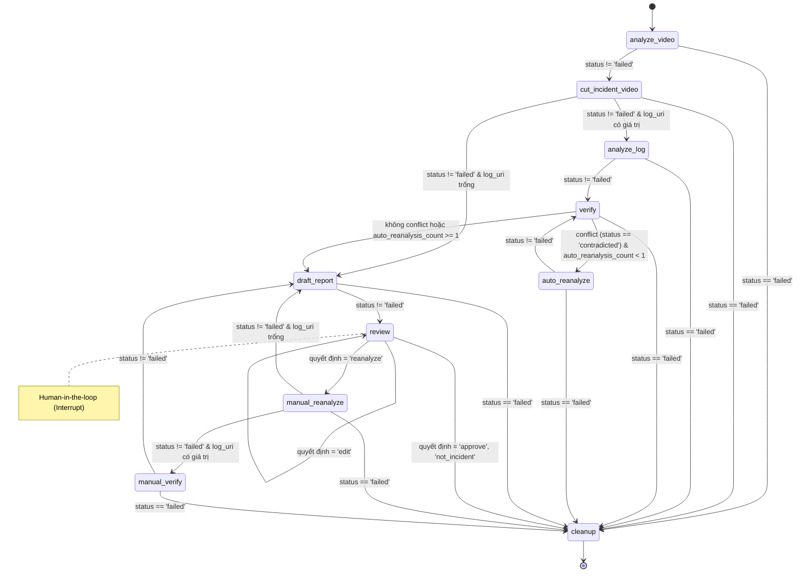

# Báo cáo Phân tích Chuyên sâu: Incident Analysis Workflow

Dưới đây là báo cáo reverse-engineering trực tiếp từ mã nguồn trong thư mục `src/`, tuân thủ tuyệt đối các nguyên tắc: dựa vào code thật, không phỏng đoán, và phân tách rõ giữa dữ liệu/xử lý.

---

## 1. Executive Summary

Hệ thống là một pipeline Agentic kết hợp giữa **FastAPI**, **LangGraph**, và các **LLM/VLM (OpenAI & Qwen)** để phân tích tự động video sự cố và đối chiếu với log phương tiện.
Thay vì gửi toàn bộ video và log cho một model khổng lồ, hệ thống chia nhỏ thành các tác vụ chuyên biệt: VLM trích xuất claims từ video → Code xử lý log bằng rule-based deterministic → LLM đối chiếu (verify) claims với log summary → VLM re-analyze nếu mâu thuẫn → LLM tổng hợp báo cáo nháp → Human Reviewer.
Tất cả đều được implement thật (không dùng mock/stub), thao tác media qua FFmpeg, và có observability (ghi vết LLM tokens, latency).

---

## 2. Workflow Mermaid (Thực tế từ `incident_graph.py`)

Dưới đây là graph thực tế được compile từ hàm `build_incident_graph` trong `src/agents/incident_graph.py`.



**Điều kiện chuyển node thực tế (trong `incident_routing.py` và `incident_graph.py`):**

- `after_verification`:
  ```python
  has_conflict = any(result.status == VerificationStatus.CONTRADICTED for result in verification.results)
  if has_conflict and state.get("auto_reanalysis_count", 0) < 1:
      return "auto_reanalyze"
  return "draft_report"
  ```
- `after_review`:
  ```python
  if state.get("status") in {"approved", "not_incident", "failed"}: return "cleanup"
  if state.get("last_review_action") == "edit": return "review"
  if state.get("last_review_action") == "reanalyze": return "manual_reanalyze"
  return "review"
  ```

---

## 3. Phân tích `IncidentState`

`IncidentState` (TypedDict trong `incident_state.py`) là "bộ nhớ" truyền qua mọi node.

| Field                    | Type                        | Tạo ở đâu                                                          | Đọc ở đâu                                   | Ý nghĩa                                                                |
| ------------------------ | --------------------------- | ---------------------------------------------------------------------- | ------------------------------------------------ | ------------------------------------------------------------------------ |
| `incident_id`          | `str`                     | API Input                                                              | Tất cả node                                    | ID của sự cố.                                                         |
| `video_uri`            | `str`                     | API Input                                                              | `analyze_video`, `cut_incident_video`        | Đường dẫn gốc video.                                                |
| `log_uri`              | `str \| None`              | API Input                                                              | Graph Router,`analyze_log`                     | Đường dẫn gốc file log CSV.                                         |
| `analysis_prompt`      | `str`                     | API Input                                                              | `analyze_video`                                | Yêu cầu phân tích từ người dùng.                                 |
| `status`               | `Literal`                 | API (`queued`), Nodes (`running`, `failed`, `awaiting_review`) | Router edges                                     | Trạng thái hiện tại của flow.                                       |
| `video_memory`         | `VideoMemory`             | `analyze_video`, `auto_reanalyze`, `manual_reanalyze`            | Các node còn lại                              | Kết quả phân tích video cấu trúc hóa.                             |
| `claims`               | `list[Claim]`             | `analyze_video`, `verify`                                          | API,`review`                                   | Copy trực tiếp từ`video_memory` ra ngoài state để dễ truy cập. |
| `log_evidence_summary` | `LogEvidenceSummary`      | `analyze_log`                                                        | `verify`, `draft_report`, `auto_reanalyze` | Tổng hợp text và metric từ code (không dùng LLM).                  |
| `log_analysis`         | `LogAnalysisResult`       | `analyze_log`                                                        | Chờ report/download                             | Kết quả phân tích thô và danh sách kiện.                         |
| `log_events`           | `list[LogEvent]`          | `analyze_log`                                                        | Báo cáo UI                                     | Các sự kiện (phanh gấp, đổi lái) detect bằng code.               |
| `chart_uris`           | `list[str]`               | `analyze_log`                                                        | UI / API                                         | Đường dẫn biểu đồ matplotlib.                                     |
| `verification`         | `VerificationResult`      | `verify`                                                             | `auto_reanalyze`, `draft_report`             | Kết quả LLM so sánh claims với log.                                  |
| `draft_report`         | `DraftReport`             | `draft_report`, `review`                                           | API                                              | Báo cáo nháp gửi cho reviewer.                                       |
| `report_narrative`     | `ReportNarrative`         | `draft_report`                                                       | N/A                                              | Khúc text do LLM viết (được nhúng luôn vào draft_report).        |
| `artifact_uris`        | `dict[str, str]`          | `cut_incident_video`, `analyze_log`                                | `review`, API                                  | Đường dẫn file local (frames, clip cắt, CSV).                       |

### Ví dụ IncidentState thực tế

```json
{
  "incident_id": "INC-1234",
  "video_uri": "./uploads/video.mp4",
  "log_uri": "./uploads/telemetry.csv",
  "status": "running",
  "analysis_prompt": "Kiểm tra xem xe có phanh trước khi va chạm không.",
  "artifact_uris": {
    "incident_clip": "/data/artifacts/INC-1234/incident_clip.mp4",
    "log_slice": "/data/artifacts/INC-1234/log_slice.csv"
  },
  "auto_reanalysis_count": 0
}
```

---

## 4. `analyze_video_node` đang thực sự làm gì?

### 4.1 Input thực tế

- Bắt buộc: `incident_id`, `video_uri`, `analysis_prompt`.
- Node lấy từ `state`.

### 4.2 Cắt/Gửi Video vào VLM

Code xử lý tùy thuộc vào config VLM adapter (`src/agents/nodes/incident.py` + `src/services/video_memory.py`):

- **Trường hợp 1: Mode TIMESTAMPED_FRAMES (OpenAI)**

  - Gọi `media.sample_frames(video_uri, ..., fps=2.0, max_frames=120)` (ffmpeg filter `fps=2.0`).
  - Gửi các frame thành mảng Base64 Images vào prompt.
  - Xử lý mượt `rolling_batches` nếu số frame vượt quá limit.
- **Trường hợp 2: Mode NATIVE_VIDEO (Qwen)**

  - Gọi `media.normalize_video` để resize/pad, chuẩn hóa FPS và mã hóa MP4 (`max_duration=60s`).
  - Gửi video đã chuẩn hóa bằng Base64 Data URL hoặc public artifact URL tới Qwen qua DashScope.

### 4.3 Prompt VLM (`src/prompts/video_analysis.py`)

Được tạo động:

- **System instructions:**
  1. Yêu cầu định vị `t_start <= t0 <= t_end` (t0 = va chạm).
  2. Cấm tạo claim ngoài khung hình. Cấm suy diễn không có bằng chứng.
  3. Bắt buộc dẫn `evidence_id` cho mọi claim.
- **Biến inject:** `user_request` (chính là `analysis_prompt`), `input_mode`.

### 4.4 Output VLM Schema

Dùng structured output `VideoMemory` (Pydantic model):

```json
{
  "global_scene": "Ngã tư trời sáng, có xe máy chạy ngang.",
  "video_summary": "Xe đi thẳng qua ngã tư và va chạm nhẹ với xe máy tại t0.",
  "incident_window": { "t_start": 2.0, "t0": 4.5, "t_end": 7.0 },
  "timeline": [{"timestamp_s": 4.5, "description": "Va chạm xảy ra.", "evidence_ids": ["frame-000009"]}],
  "claims": [{"claim_id": "C1", "text": "Xe đạp phanh mạnh", "timestamp_s": 3.0, "evidence_ids": ["frame-000006"], "verification_status": "unverified"}],
  "observations": [], "tracked_entities": [], "uncertainties": [], "evidence": [],
  "source_frame_ids": [], "revision": 1, "analysis_mode": "native_video", "remote_media_handles": []
}
```

---

## 5. `video_memory` chính xác là gì?

Là một Pydantic Model trung tâm (`VideoMemory` trong `models/incidents.py`).
Nó lưu trữ toàn bộ bối cảnh được phân tích ra.

| Field               | Type                        | Ý nghĩa                                                                                     |
| ------------------- | --------------------------- | --------------------------------------------------------------------------------------------- |
| `incident_window` | `IncidentWindow`          | Khoảng thời gian xảy ra sự cố (t_start, t0, t_end).                                      |
| `timeline`        | `list[TimelineEvent]`     | Dòng thời gian chi tiết.                                                                   |
| `claims`          | `list[Claim]`             | Các mệnh đề cần kiểm chứng (nằm TRONG video_memory, state chỉ giữ alias ra ngoài). |
| `evidence`        | `list[EvidenceReference]` | Nơi map`evidence_id` với frame thật hoặc timestamp thật.                               |

**Luồng dữ liệu:**

- `analyze_video` TẠO RA `video_memory`.
- `cut_incident_video` DÙNG `video_memory.incident_window` để tính t_start, t_end.
- `analyze_log` DÙNG `video_memory.incident_window` để slice CSV.
- `verify` DÙNG `video_memory.claims` để gửi đi xác minh.

---

## 6. Claims được tạo như thế nào?

Một `Claim` đại diện cho một "luận điểm" (mệnh đề thực tế) mà VLM trút ra từ việc quan sát, và sau đó cần phải đối chiếu với log.
Schema thực tế:

```json
{
  "claim_id": "claim_01",
  "text": "Tài xế bẻ lái sang trái.",
  "timestamp_s": 14.5,
  "evidence_ids": ["frame-000010"],
  "verification_status": "unverified"
}
```

*(Code không phân biệt kỹ giữa "Observation" và "Interpretation", tất cả được gom vào Claim miễn là do VLM xuất ra)*.

---

## 7. `cut_incident_video_node` cắt video bằng gì?

Thực tế dùng subprocess gọi **FFmpeg CLI** (`src/services/media.py` -> `MediaService.cut_incident_clip`).

- **Start/End:** Lấy từ `incident_window` cộng thêm padding: `pre_roll_s` (1s), `post_roll_s` (2s).
- **Rule:** Đảm bảo `min_duration_s=5.0`. Nếu đoạn cắt quá ngắn, nó sẽ tự động nới lỏng về phía sau (post).
- **Lưu trữ:** Lưu file `mp4` vào local `artifact_dir` (`./data/artifacts/<ID>/incident_clip.mp4`).
- **Command ffmpeg tương đương:**
  ```bash
  ffmpeg -y -ss 11.4 -i input.mp4 -t 7.3 -c:v libx264 -pix_fmt yuv420p -c:a aac -movflags +faststart output.mp4
  ```

---

## 8. Log được đọc và cắt như thế nào?

Code trong `src/services/log_analysis.py`.

- **Hỗ trợ format:** Chỉ hỗ trợ **CSV UTF-8**.
- **Cột Timestamp:** Tự tìm cột `timestamp_s`, `time_s`, `time` (aliases). Timestamp phải là giây (float >= 0).
- **Cắt Slice:** Chỉ giữ lại các row có `t_start <= timestamp_s <= t_end`. Ghi ra `log_slice.csv`.
- **Hệ quy chiếu:** Timestamp Log giả định **đồng bộ 1-1 (100% absolute alignment)** với Timestamp Video.

---

## 9. `log_analysis` và `log_evidence_summary` đang chứa gì?

Code **tự chạy rule** (không dùng AI) để build ra summary.
`log_evidence_summary` là JSON object cấu trúc:

```json
{
  "summary": "Log được cắt trong khoảng [2.0, 7.0] giây. Tốc độ đầu 45 km/h, tốc độ cuối 0 km/h...",
  "metrics": {
    "speed_start": 45.0,
    "max_deceleration": -10.2,
    "disengagement_time": 4.1
  },
  "events": [...],
  "evidence_ids": ["log-metric:speed_start", "log-event:4.100:disengagement"],
  "warnings": [],
  "errors": []
}
```

**Node `verify` CHỈ NHẬN `log_evidence_summary` này**, nó không hề nhìn thấy toàn bộ raw CSV log!

---

## 10. `log_events` được detect như thế nào? (Rule-based)

Các event hard-code rule trong `_detect_events` (`log_analysis.py`):

1. **BRAKE_ONSET**: `brake[i] - brake[i-1] >= 0.3`
2. **STEERING_CHANGE**: `abs(steer[i] - steer[i-1]) >= 10.0`
3. **DISENGAGEMENT**: Autonomy chuyển từ `1` (true) sang `0` (false) (Alias: autonomous_state, autopilot...)
4. **WARNING/ERROR**: Quét các cột `warning`, `error`.

---

## 11. Chart được tạo như thế nào?

Sử dụng thư viện `matplotlib` lưu ra file `.png` (không lưu SVG hay HTML) ở chế độ `Agg` backend.
Có 4 chart: `01_speed_acceleration.png`, `02_brake_throttle.png`, `03_steering.png`, `04_autonomy_events.png`. Vẽ luôn vạch đỏ cho `t_start`, `t0`, `t_end`.

---

## 12. `align_and_verify_claims_node` hoạt động CHÍNH XÁC như thế nào?

**Lưu ý lớn:** Verifier (LLM) **KHÔNG hề xem lại video**.
Implementation là mô hình **"Claim vs Text Summary"**.
LLM nhận Input:

1. Danh sách `claims` (Text + Timestamp) do VLM sinh ra.
2. `log_evidence_summary` (Dạng dictionary & string) do backend code sinh ra.

### 12.1 Prompt Verifier (`src/prompts/verification.py`)

Yêu cầu model so sánh: "Chỉ kiểm chứng claim bằng log... Trả về supported hoặc contradicted... evidence_ids chỉ được lấy từ allowed_log_evidence_ids (do code báo cáo)."

### 12.2 Output Schema (`VerificationResult`)

```json
{
  "results": [
    {
      "claim_id": "C1",
      "status": "contradicted",
      "reason": "Log cho thấy xe không hề đạp phanh (max_brake = 0) tại giây 3.0",
      "evidence_ids": ["log-metric:max_brake"]
    }
  ]
}
```

Sau đó `claim` ban đầu trong state sẽ được update status thành `contradicted`.

---

## 13. Auto reanalysis hoạt động như thế nào?

Triggers NẾU có claim `CONTRADICTED` và `auto_reanalysis_count < 1`.
Nó **gửi lại video/frames cho VLM** kèm theo feedback!

**Prompt (`src/prompts/reanalysis.py`):**
Gửi cho VLM một context chứa:

- `conflict_claims`
- `verification_reasons` (Ví dụ: "Log báo không có phanh")
- `log_evidence_summary`
  VLM được yêu cầu nhìn lại video, kết hợp feedback từ log để sinh ra một bản Vá (Patch) cập nhật lại claim (sửa text, xóa, hoặc đổi nhận định).

---

## 14. Tại sao sau auto reanalysis lại chạy `verify` lần nữa?

Sau khi VLM sửa text của claim (Ví dụ: từ "Xe đạp phanh" thành "Xe chỉ thả ga giảm tốc từ từ"), claim đó trở về trạng thái `UNVERIFIED`. Hệ thống phải chạy Node `verify` lần 2 để LLM so sánh text claim mới với log summary xem đã khớp chưa (`SUPPORTED`).

---

## 15. `build_draft_report_node` thực sự làm gì?

Backend tự ghép các object (`incident_window`, metrics, warnings, evidence array).
LLM **CHỈ sinh ra phần Text Narrative** (`ReportNarrative` trong `reporting.py`):

```json
{
  "summary": "Mô tả ngắn gọn sự cố...",
  "timeline": "Diễn biến sự kiện theo thời gian...",
  "hypothesized_causes": "Nguyên nhân nghi vấn..."
}
```

LLM bị ép schema và ép chỉ sử dụng `evidence_ids` tồn tại trong mảng cho trước.

---

## 16. Human Review & Chỉnh sửa (Edit)

Dùng LangGraph `interrupt()` để treo quá trình.
Có 4 action API hỗ trợ:

- `approve` / `not_incident`: Kết thúc graph (`cleanup`).
- `edit`: **KHÔNG GỌI LLM!** Backend tự chèn đè (overwrite) text trực tiếp vào dictionary của `draft_report`.
- `reanalyze`: Người dùng gửi feedback (Ví dụ: "Hãy xem kỹ lại xe đạp đằng sau"), state sẽ trigger `manual_reanalyze` cho VLM quét lại. Khác với Auto ở chỗ Trigger và Feedback là từ Con người.

---

## 17. API → Graph Flow

`POST /incidents` -> Nhận JSON request (Pydantic `IncidentCreateRequest`).
-> `incident_workflow_service.create()`
-> Gọi `graph.ainvoke(IncidentState, {"configurable": {"thread_id": incident_id}})` (Tạo state initial và lưu checkpoint vào SQLite / Postgres qua checkpointer).
-> Return HTTP 202 Accepted.

---

## 18. Các rủi ro Kiến trúc & Đánh giá Implementation

### A. Triển khai rất Tốt

- **Video Memory Schema**: Cực kỳ mạnh mẽ. Tách bạch Claims, Evidence, Observations.
- **FFmpeg & Media Handling**: Tự động parse duration, chống treo process bằng timeout timeout an toàn, support rolling batches để né token limit.
- **Structured Outputs**: Sử dụng `.parse()` pydantic mode của OpenAI SDK đảm bảo JSON không bao giờ lỗi format.

### B. Nguy cơ Kiến trúc cần lưu ý

1. **Bias trong Auto Reanalysis (AI Hallucination Bias)**:
   Khi VLM bị mâu thuẫn, hệ thống nhét "Log Evidence" vào prompt và bảo nó nhìn lại. Nguy cơ lớn: VLM có thể "chiều ý" Log và tự bịa ra quan sát ảo trong video để khớp với log, đánh mất tính độc lập khách quan của Camera.
2. **"Tên lừa tình" - `align_and_verify_claims`**:
   Người dùng tưởng model verify Video với Log. Sự thật: Node này chỉ verify "Câu chữ (Text claim)" với "Log Summary (Text)". Nếu VLM nhìn sai từ bước 1, Verification sẽ chỉ so rác với log.
3. **Đồng bộ Timestamp (Temporal Drift)**:
   Code giả định `timestamp_s` trong CSV và giây trong Video là một (Absolute sync 0.0s). Trên thực tế xe tự lái, log có epoch UnixTime còn Video đếm từ 0, nếu không synchronize, toàn bộ Log Slice và Verify sẽ trật nhịp hoàn toàn!

---

## 19. Mô phỏng luồng (Concrete Example)

**Input:** Video 40s (có va chạm lúc 18s). Log telemetry.

- **Node analyze_video:** Trả về `video_memory` với `t_start=15.0, t0=18.0, t_end=22.0`. Sinh Claim C1: "Tài xế phanh gấp lúc 17s".
- **Node cut_clip:** Dùng ffmpeg cắt từ 14s đến 24s.
- **Node analyze_log:** Slicing CSV từ 15s - 22s. Rule check `brake` không tăng.
- **Node verify:** Gửi Claim C1 + "Max brake = 0" cho LLM. LLM trả về `CONTRADICTED` vì không thấy phanh.
- **Node auto_reanalyze:** Báo lỗi lại cho VLM: "Log nói không phanh". VLM đính chính: "Nhìn nhầm bóng râm thành đèn phanh, xe không phanh". Sửa Claim C1 thành "Xe không giảm tốc".
- **Node verify (lần 2):** LLM duyệt lại, C1 giờ là `SUPPORTED`.
- **Node draft_report:** Tạo báo cáo. Graph treo ở `interrupt`.
- **Human Review:** Chuyên gia duyệt, API gửi `{"action": "approve"}` -> Graph nhảy sang `cleanup`. END.
