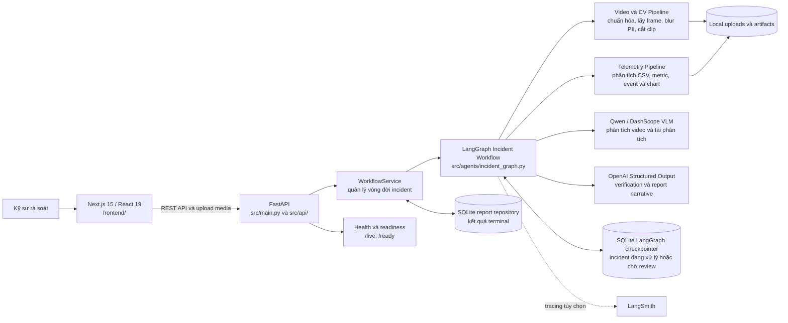
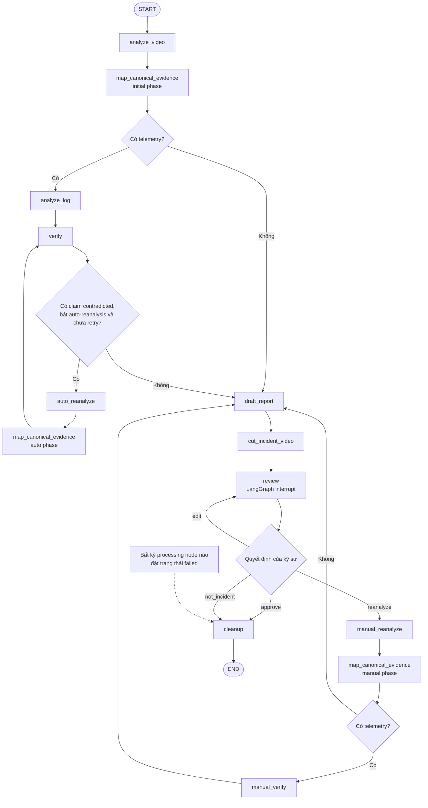
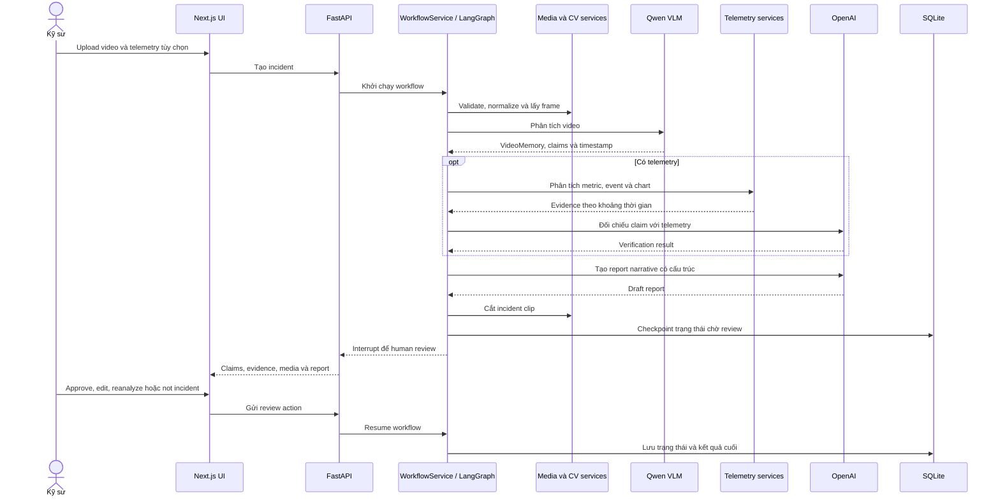

# VLens Architecture Diagram

Tài liệu này mô tả kiến trúc hiện tại của VLens: hệ thống tiếp nhận video hành trình và dữ liệu telemetry, dùng AI để trích xuất bằng chứng sự cố, tạo báo cáo và chuyển cho kỹ sư xác nhận.

## 1. System Overview

## 2. Incident Processing Workflow

Các tên node trong sơ đồ dưới đây khớp với graph được khai báo trong `src/agents/incident_graph.py`.

### Routing rules

- Video là dữ liệu bắt buộc; telemetry là dữ liệu tùy chọn.
- Sau phân tích video, bằng chứng được chuẩn hóa thành canonical evidence trước khi kiểm chứng hoặc tạo báo cáo.
- Nếu có telemetry, mỗi claim được đối chiếu và gán trạng thái `supported`, `contradicted` hoặc `unverified`.
- Auto-reanalysis chỉ chạy khi có claim bị mâu thuẫn, tính năng được bật và incident chưa dùng lượt retry tự động.
- `review` là điểm human-in-the-loop. Workflow tạm dừng tại đây cho tới khi kỹ sư chỉnh sửa, yêu cầu phân tích lại, phê duyệt hoặc kết luận không phải sự cố.
- Các trạng thái terminal được dọn tài nguyên tạm và lưu kết quả vào report repository.

## 3. Data and Evidence Flow

## 4. Main Components

| Layer | Component | Responsibility |
|---|---|---|
| Frontend | `frontend/` | Upload dữ liệu, theo dõi tiến trình, hiển thị incident, evidence, telemetry chart và màn hình review. |
| API | `src/main.py`, `src/api/` | REST endpoints, upload, incident lifecycle, review actions, settings và health checks. |
| Application | `WorkflowService` | Khởi tạo, tiếp tục và truy vấn workflow; kết nối API với LangGraph và persistence. |
| Orchestration | `src/agents/incident_graph.py` | Điều phối toàn bộ pipeline, retry, routing, checkpoint và human-in-the-loop interrupt. |
| Routing | `src/agents/incident_routing.py` | Quyết định nhánh đi tiếp dựa trên phase, telemetry, verification và review action. |
| Video AI | Qwen / DashScope VLM | Phân tích video, tạo VideoMemory, claim, mô tả bằng chứng và tái phân tích theo feedback. |
| Verification và reporting | OpenAI structured output | Đối chiếu bằng chứng telemetry và tạo narrative báo cáo có cấu trúc. |
| Media/CV | Media và CV services | Kiểm tra file, chuẩn hóa video, lấy frame, phát hiện và làm mờ PII, cắt video sự cố. |
| Telemetry | Telemetry services | Đọc dữ liệu xe, tính metric, phát hiện event, dựng chart và tạo evidence theo timestamp. |
| Persistence | SQLite | LangGraph checkpoints cho incident hoạt động và report repository cho kết quả terminal. |
| Observability | LangSmith và model activity | Theo dõi trace AI tùy chọn, trạng thái xử lý và hoạt động model. |

## 5. Persistence and Artifact Ownership

| Data | Storage | Lifecycle |
|---|---|---|
| Video và telemetry tải lên | Local upload storage | Được giữ trong quá trình xử lý; tài nguyên tạm được cleanup khi workflow kết thúc hoặc thất bại. |
| Frame, chart, evidence và incident clip | Local artifact storage | Được tham chiếu bởi incident và báo cáo để kỹ sư rà soát. |
| Workflow state | SQLite LangGraph checkpointer | Lưu trạng thái node, interrupt và dữ liệu cần thiết để resume review. |
| Báo cáo đã phê duyệt hoặc `not_incident` | SQLite report repository | Lưu kết quả terminal để truy xuất sau khi workflow hoàn tất. |
| AI traces | LangSmith, nếu được cấu hình | Dùng cho quan sát và debug; không phải nguồn dữ liệu nghiệp vụ chính. |

## 6. Deployment Boundary

- Frontend và FastAPI là hai runtime độc lập, giao tiếp qua REST API.
- Các provider AI là dịch vụ bên ngoài; API key và model được cấu hình qua settings/environment.
- Baseline hiện tại dùng SQLite và local filesystem. Kiến trúc không phụ thuộc PostgreSQL, ChromaDB hoặc RAG/vector database.
- Health endpoints tách liveness và readiness để kiểm tra tiến trình API và các dependency cần thiết.
